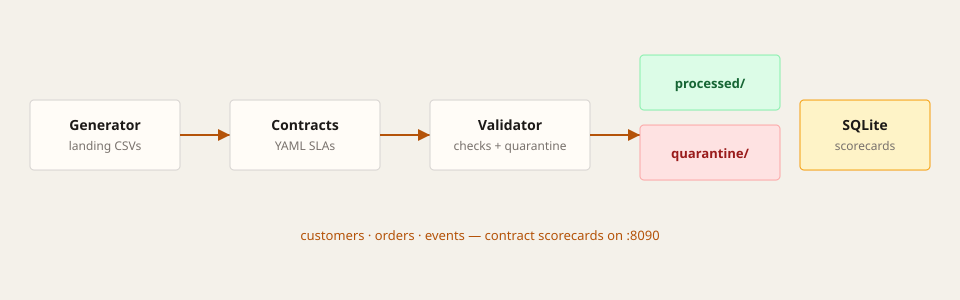

# Data Contract Scorecards

Batch **data-quality / observability** demo for a data engineering portfolio — deliberately different from the [streaming fraud pipeline](https://github.com/jaimedelope/streaming-fraud-pipeline).

| | Fraud pipeline | This project |
|--|----------------|--------------|
| Problem | Real-time anomaly scoring | Warehouse **data contracts** + SLA scorecards |
| Shape | Continuous event stream | CSV **batches** landed on disk |
| Store | Kafka + Redis feeds | Files + **SQLite** history |
| UI | Live streaming ops board | Contract scorecards + YAML browser |
| Port | `:8088` | `:8090` |

**Flow:** synthetic table extracts → YAML contracts → validator → pass/quarantine folders → scorecard UI

## Live demo

**[data-quality-pipeline-two.vercel.app](https://data-quality-pipeline-two.vercel.app)**

Static browser simulation of the scorecards (no Docker). The real stack is below.

## Architecture

```text
┌─────────────┐   CSV batches    ┌────────────────┐
│  Generator  │ ───────────────► │ data/landing/* │
└─────────────┘                  └───────┬────────┘
                                         │
                                         ▼
┌─────────────┐   YAML contracts ┌────────────────┐
│  contracts/ │ ───────────────► │   Validator    │
└─────────────┘                  └───────┬────────┘
                                         │
                    ┌────────────────────┼────────────────────┐
                    ▼                    ▼                    ▼
             data/processed/      data/quarantine/     quality.db (SQLite)
                                         │
                                         ▼
                               ┌────────────────┐
                               │   Dashboard    │
                               │     :8090      │
                               └────────────────┘
```



### Datasets & contracts

| Dataset | Owner | Examples of rules |
|---------|-------|-------------------|
| `customers` | growth-analytics | unique id, email pattern, allowed countries, row-count band |
| `orders` | commerce-analytics | amount range, status enum, FK → customers, null-rate SLA |
| `events` | product-analytics | event name enum, freshness window, uniqueness |

Failed batches are moved to `data/quarantine/<dataset>/`. Passing batches go to `data/processed/`.

## Quick start

```bash
docker compose up --build
```

Open [http://localhost:8090](http://localhost:8090)

You should see scorecards for `customers`, `orders`, and `events` within ~15 seconds.

```bash
docker compose down -v
```

## Project layout

```text
contracts/     # YAML data contracts (source of truth)
generator/     # writes landing CSVs for three datasets
validator/     # contract checks → SQLite + quarantine/processed
dashboard/     # FastAPI scorecard UI
web/           # static Vercel demo
docs/
docker-compose.yml
```

## Why this belongs on the portfolio

It shows **analytical engineering** concerns: ownership, contracts, SLAs, quarantine, and historical pass rates — complementary to streaming fraud detection (online scoring) rather than a second copy of it.

## Next ideas (v2)

- Great Expectations / Pandera as the engine behind the same contracts
- Airflow/Prefect schedule + warehouse write (BigQuery/Snowflake)
- Slack alert on SLA breach
- Quarantine browser with row-level repair & replay
